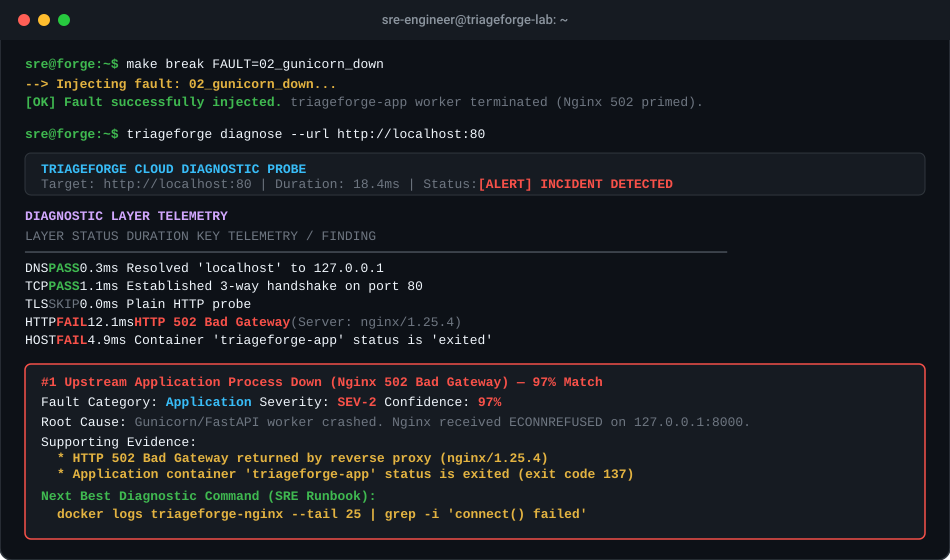

# TriageForge 🔨

> **A deterministic cloud failure triage lab, automated diagnosis engine, and support case simulation platform.**  
> Built for Cloud Support Engineers (CSE) and Site Reliability Engineers (SRE).

[](https://github.com/NotMayankfr/TriageForge/actions)


---

## 🎬 Triage In Action



---

## 📌 Executive Summary

Modern web services don't just crash with obvious stack traces—they fail silently in subtle, layered ways: a security group packet drop that manifests as an HTTP client timeout; an unrotated log file exhausting disk inodes while raw bytes still show free space; or orphaned PostgreSQL transactions consuming client slots until the entire microservice pool enters deadlock.

**TriageForge** is an engineering lab that:
1. **Deploys a realistic production stack**: `Nginx` (Reverse Proxy & TLS) $\rightarrow$ `Gunicorn / FastAPI` (ASGI Application) $\rightarrow$ `PostgreSQL` (Relational Storage) + `Mock S3` & `SSHD Bastion`.
2. **Injects 10 realistic, hardened failure scenarios** across the Network, Compute, Storage, Database, and Security tiers.
3. **Executes bottom-up automated triage** through a deterministic, evidence-backed diagnosis engine that ranks root-cause hypotheses with exact confidence scores.
4. **Delivers enterprise-grade support artifacts**: 3 deeply polished enterprise support-case post-mortems and 8 actionable SRE runbooks.

---

## 🏛 System Architecture

```
                          CLIENT / BROWSER
                                 │
                                 ▼
                     ┌───────────────────────┐
                     │   triageforge CLI     │
                     │  (Diagnostic Probe)   │
                     └───────────┬───────────┘
                                 │
                 ┌───────────────┴───────────────┐
                 │    PORT 80 (HTTP) / 443 (TLS) │
                 ▼                               ▼
       ┌───────────────────┐           ┌───────────────────┐
       │   Nginx Ingress   │           │    SSHD Bastion   │
       │  (Reverse Proxy)  │           │    (Port 2222)    │
       └─────────┬─────────┘           └───────────────────┘
                 │ (Unix Socket / Port 8000)
                 ▼
       ┌───────────────────┐
       │ Gunicorn Worker   │
       │  (FastAPI ASGI)   │
       └────┬──────────┬───┘
            │          │
            ▼          ▼
     ┌───────────┐   ┌────────────────────────┐
     │PostgreSQL │   │ Mock S3 Storage Engine │
     │ (Port 5432)│   │       (Port 9000)      │
     └───────────┘   └────────────────────────┘
```

---

## 🔍 The Bottom-Up Diagnostic Hierarchy

TriageForge avoids guessing by inspecting every layer from the physical wire up to the application payload:

```
  Layer 1: DNS Resolution      → Resolves A/AAAA records, latency, NXDOMAIN, SERVFAIL
  Layer 2: TCP Transport       → Distinguishes TIMEOUT (firewall/blackhole) from REFUSED (crashed process)
  Layer 3: TLS / SSL           → Certificate expiry dates, SAN matching, trust chain integrity
  Layer 4: HTTP & Timing       → DNS time, TCP handshake, TLS time, TTFB, status codes & body signatures
  Layer 5: Host & Container    → Disk space & inodes (df -h / df -i), OOM killer (exit 137), pg_stat_activity
  Layer 6: Cloud & AWS         → Security Groups, VPC Route Tables, EC2 status checks, CloudWatch alarms
```

### 🧠 Why Deterministic Rules Beat LLMs for L1–L3 Triage
In production incident response, hallucination is unacceptable. If an LLM tells an on-call engineer that a `502 Bad Gateway` is caused by "bad DNS records", it wastes critical minutes of MTTR.

TriageForge relies on **deterministic hypothesis scoring**:
- A **TCP timeout** with successful DNS is mathematically verified as a packet drop (Security Group or iptables DROP), never connection refused.
- A **TCP connection refused** is mathematically verified as an absent listener or crashed process.
- Findings yield concrete confidence percentages ($0.0 \rightarrow 1.0$), specific supporting evidence, and the exact next shell command an L2/L3 SRE should execute.

---

## 💥 The 10 Failure Scenarios

Each fault is self-contained in `faults/<id>/` with an automated `break.sh`, `fix.sh`, and `expected.json`.

| # | Fault Identifier | Category | Observed Symptom | Primary Diagnostic Fingerprint | Expected Conf. |
|:---:|:---|:---:|:---|:---|:---:|
| **01** | `01_sg_block` | Network | `curl` hangs indefinitely | TCP handshake timeout; SYN sent, zero SYN-ACK or RST returned | `96%` |
| **02** | `02_gunicorn_down` | Application | Nginx returns HTTP 502 | Upstream `127.0.0.1:8000` connection refused; worker crashed | `97%` |
| **03** | `03_disk_full` | Storage | App returns 500 / `ENOSPC` | Disk mount $>95\%$ or inode table exhausted; `df -h` / `df -i` | `98%` |
| **04** | `04_pg_connections` | Database | `too many clients already` | `pg_stat_activity` active connections $\ge$ `max_connections` | `98%` |
| **05** | `05_missing_route` | Network | Outbound calls fail / no route | Kernel returns `EHOSTUNREACH` / missing `0.0.0.0/0` gateway | `94%` |
| **06** | `06_bad_dns` | Network | Name does not resolve | `getaddrinfo` fails; NXDOMAIN or nameserver timeout | `99%` |
| **07** | `07_expired_tls` | Security | Browser / curl cert error | `notAfter` in past or requested host not in certificate SANs | `96%` |
| **08** | `08_iam_s3_denied` | Security | HTTP 403 Forbidden | AWS S3 XML payload contains `<Code>AccessDenied</Code>` | `95%` |
| **09** | `09_oom_killed` | Compute | Container abruptly terminates | Linux kernel OOM killer logged in `dmesg`; exit code 137 | `99%` |
| **10** | `10_ssh_lockout` | Security | `Permission denied (publickey)` | Insecure file mode on `~/.ssh` or `authorized_keys` (777 vs 600) | `95%` |

---

## 🚀 Quickstart Guide (Local Mode)

Zero cloud costs. Runs entirely inside Docker Compose in WSL2, Linux, or macOS.

### 1. Clone & Install
```bash
git clone https://github.com/NotMayankfr/TriageForge.git
cd TriageForge

# Install CLI in editable mode
pip install -e ".[dev]"
```

### 2. Boot the Lab Stack
```bash
make up
# Or: docker compose -f stack/docker-compose.yml up -d --build
```

### 3. Run a Baseline Diagnosis
```bash
triageforge diagnose --url http://localhost:80
```
*Output: All layers green, status 200 OK, TTFB $<15\text{ms}$.*

### 4. Inject a Fault & Watch TriageForge Diagnose It
```bash
# Inject Fault 02 (Kill Gunicorn)
make break FAULT=02_gunicorn_down

# Run the automated diagnosis
triageforge diagnose --url http://localhost:80
```
TriageForge will immediately identify:
- **Layer 4**: FAIL (HTTP 502 Bad Gateway)
- **Top Hypothesis**: Upstream Application Process Down (97% Match)
- **Next Best Command**: `docker logs triageforge-nginx --tail 25 | grep -i 'connect() failed'`

### 5. Recover the Stack
```bash
make fix FAULT=02_gunicorn_down
```

---

## 💻 CLI Usage & Report Formats

### Interactive Terminal Visualization
```bash
triageforge diagnose --url http://localhost:80
```

### Incident Training Drill Mode ("Dojo")
Gamified real-time outage drills for onboarding and interview preparation:
```bash
# Start an incident drill (injects a realistic fault quietly with a customer ticket)
triageforge dojo start

# Request progressive L1 -> L2 -> L3 investigation hints
triageforge dojo hint

# Submit your diagnosed root-cause fault ID
triageforge dojo submit 02_gunicorn_down

# Automatically cancel drill and heal the stack
triageforge dojo stop
```

### Low-Level Packet Capture (.pcap) Analyzer
Inspects binary libpcap files for silent SYN drops, TCP resets, and retransmissions:
```bash
triageforge pcap docs/fixtures/sample_traffic.pcap
```

### AWS VPC Flow Log & Web Log Analyzer
Surfaces security group drops and elevated 5xx server error distributions:
```bash
# Analyze VPC Flow Logs for rejected traffic flows
triageforge logs --type vpc-flow docs/fixtures/sample_vpc_flow.log

# Analyze Nginx access logs for 502/504 error spikes
triageforge logs --type nginx docs/fixtures/sample_nginx_access.log
```

### Export to Markdown (for Jira / ServiceNow Tickets)
```bash
triageforge diagnose --url http://localhost:80 --format markdown -o incident_report.md
```

### Export to JSON (for CI/CD Gateways & Webhooks)
```bash
triageforge diagnose --url http://localhost:80 --format json
```

### List All Catalogued Fault Scenarios
```bash
triageforge list-faults
```

---

## 📑 Support-Case Post-Mortem Portfolio

Explore the polished post-mortems in [`docs/cases/`](docs/cases/):

1. [**CASE-2024-0891: Upstream Worker Starvation (Nginx 502 Bad Gateway)**](docs/cases/CASE-2024-0891_nginx_502_upstream_worker_crash.md)  
   *Deep analysis of Gunicorn synchronous worker heartbeat timeouts under sudden traffic surges, upstream keepalive tuning, and socket buffer starvation.*
2. [**CASE-2024-1104: Silent Egress Packet Drop (Security Group / iptables Blackhole)**](docs/cases/CASE-2024-1104_silent_egress_blackhole_timeout.md)  
   *Low-level packet capture (`tcpdump`) showing TCP SYN retransmissions without RST, isolating stateful hypervisor drops from application-tier outages.*
3. [**CASE-2024-1422: PostgreSQL Connection Pool Saturation (`max_connections`)**](docs/cases/CASE-2024-1422_postgres_connection_pool_exhaustion.md)  
   *Detailed investigation of leaked `idle in transaction` connections in asynchronous FastAPI background tasks and deploying PgBouncer transaction pooling.*

### SRE Runbook Catalog
Runbooks for every fault are available in [`docs/runbooks/`](docs/runbooks/):
- [`RUNBOOK-01_sg_block.md`](docs/runbooks/RUNBOOK-01_sg_block.md)
- [`RUNBOOK-03_disk_full.md`](docs/runbooks/RUNBOOK-03_disk_full.md)
- [`RUNBOOK-05_missing_route.md`](docs/runbooks/RUNBOOK-05_missing_route.md)
- [`RUNBOOK-06_bad_dns.md`](docs/runbooks/RUNBOOK-06_bad_dns.md)
- [`RUNBOOK-07_expired_tls.md`](docs/runbooks/RUNBOOK-07_expired_tls.md)
- [`RUNBOOK-08_iam_s3_denied.md`](docs/runbooks/RUNBOOK-08_iam_s3_denied.md)
- [`RUNBOOK-09_oom_killed.md`](docs/runbooks/RUNBOOK-09_oom_killed.md)
- [`RUNBOOK-10_ssh_lockout.md`](docs/runbooks/RUNBOOK-10_ssh_lockout.md)

---

## 🧪 Automated Testing Harness

The entire test suite is verified via `pytest`:
```bash
pytest tests -v
```
Tests include:
- `test_engine.py`: Unit tests asserting deterministic scoring across all 10 failure profiles.
- `test_layers.py`: Validating socket timeout separation, TLS expiration, and signature parsing.
- `test_faults_harness.py`: Validating that every fault directory adheres to the break/fix/expected schema.
- `test_cli.py`: Click CLI regression coverage.

---

## ☁️ Future AWS Mode (Terraform Ready)

The repository includes a production-style, zero-cost AWS Terraform stack in [`stack/terraform/`](stack/terraform/):
- **Components**: VPC, public subnet, free-tier `t3.micro` EC2 instance, security group, IAM execution role, S3 bucket, CloudWatch CPU alarm with SNS.
- **Cost Guardrails**: Zero NAT Gateways, zero Application Load Balancers. Everything is spun up and torn down via a single command:
  ```bash
  cd stack/terraform
  terraform init
  terraform apply
  
  # When done, tear down immediately:
  bash teardown.sh
  ```

---

## 🎯 What TriageForge Proves in Interviews

- **Dive Deep**: You diagnose from low-level evidence (socket states, TCP flags, kernel OOM dmesg, inode consumption), not guesses.
- **Customer Obsession**: Diagnostic outputs are formatted as clear, actionable runbook commands and polished incident reports that reduce MTTR for end-users.
- **Ownership**: You built the application, reverse proxy, database, fault injectors, automated testing harness, and CI/CD pipelines end-to-end.
- **Bias for Action**: A fully working, reproducible CLI that can be cloned and demonstrated live in 60 seconds.

---

## 📄 License
MIT License. Built by Mayank for real-world SRE and Cloud Support Engineering practice.
